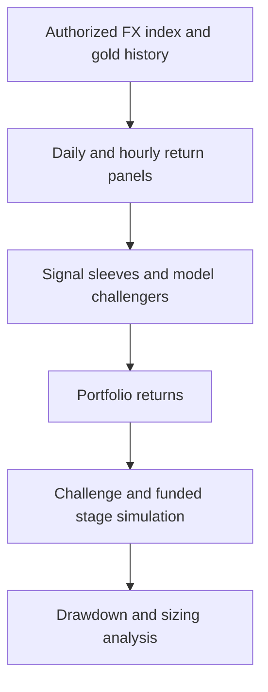

# Prop Firm Risk Research

Research simulations of multi-asset strategies, drawdown constraints, challenge outcomes and position-sizing tradeoffs.

## Research workflow



The diagram describes the research components, not verified performance or an automated live-trading service.

## Setup

Use Python 3.10 or newer for modern source syntax. Dependencies are inferred from the included source and are not a tested version lock.

```powershell
python -m venv .venv
.venv\Scripts\python -m pip install -r requirements.txt
```

On macOS/Linux use `.venv/bin/python`. Review local input paths before running scripts; some scripts perform work at import time. Clean installation and full experiments have not been verified for this release.

## Data and run order

This is a collection of experiments with external workspace dependencies, not a standalone one-command application. `pf_lib.py` treats the repository parent as the shared workspace. Preserve these sibling names or adapt the explicit paths before running:

| Sibling folder | Required material for relevant experiments |
|---|---|
| `forexStrategyDesign` | FX/index H1 bars and rates inputs |
| `xauusd_system` | Raw gold H1 history under `results_phase0/raw/` |
| `gold_hist_Data` | Cleaned gold data and `phase5_literature` source |
| `XAUUSDstrat02` | Gold H1/D1 history under `ohlc_xauusd/` |
| `arxiv_papers` | Locally authorized literature for optional extraction tools |

The published [gold research repository](https://github.com/masa12012004/gold-strategy-validation) can be checked out locally as `gold_hist_Data` to supply its source, but it does not contain market data. Likewise, [the XAUUSD pipeline](https://github.com/masa12012004/xauusd-multitimeframe-research) does not bundle the historical files referenced here.

`p00_fetch_long_daily.py` downloads long daily data; `p01_data.py` combines it with the sibling inputs into `data/daily_ret.parquet` and `data/hourly_ret.parquet`. The `p02` through `p08` scripts then investigate sleeves, models, portfolio returns and challenge/funded-stage simulations. Inspect inputs before running each script; some execute work at import time.

The `q` scripts are additional experiment branches with explicit dependencies on earlier result files, including legacy snapshots. They are not a universal numerical run sequence. Paper extraction utilities need local paper files and are optional; no papers or extracted full texts are distributed.

The cTrader live bridge and its IO/account state are excluded from this research release. Firm-specific limits, costs and payout rules embedded in the simulations are historical research assumptions and must not be treated as verified current rules or promises of passing a challenge.

## Source guide

| File | Purpose from source documentation |
|---|---|
| `p00_fetch_long_daily.py` | Fetch long daily history (Yahoo) for signal warm-up and long-sample validation only. |
| `p01_data.py` | Build the two return panels used everywhere. |
| `p02_sleeves.py` | Evaluate the candidate sleeves, each with parameters fixed from the literature. |
| `p03_reversal_variants.py` | Index dip-buying: 6 pre-listed variants, ranked on the DESIGN block only. |
| `p04_ml.py` | Does machine learning / deep learning add a forecast the rule-based sleeves lack? |
| `p04b_hybrid.py` | Hybrid: does the ML/DL ensemble forecast improve the rule-based book when used as a tilt or a veto? |
| `p05_book.py` | Build the tradable book and its hour-by-hour P&L on the broker window. |
| `p06_challenge.py` | FundedHive 2-step challenge: exact-rule simulator, optimal risk policy, pass probabilities. |
| `p07_funded.py` | Funded stage: what the account is worth after passing. |
| `p08_figures.py` | Figures for the report (static PNG). Palette: dataviz reference categorical order. |
| `pf_lib.py` | Shared library: universe, data loading, signals, portfolio construction, stats. |
| `q00_extract_papers.py` | Extract full text of every paper in the three literature folders; write a per-paper digest |
| `q01_digest.py` | Research utility; inspect inputs and configuration in the source. |
| `q10_daily_battery.py` | Daily-frequency strategies taken from the three literature folders, one engine, one protocol. |
| `q11_intraday_battery.py` | Hourly strategies from the papers on broker H1 data (14 instruments, 2021-11 .. 2026-10). |
| `q12_dl_rl.py` | Deep-learning and reinforcement-learning models from the papers that p04_ml.py did not cover. |
| `q13_hybrids.py` | Hybrids built ONLY from what cleared the pre-declared bar on DESIGN and VALID |
| `q14_challenge_final.py` | Challenge and funded-stage statistics for the book chosen by the no-look rule (q13: H1), |
| `q15_f2f_gold.py` | Forecast-to-Fill (gold folder) implemented from the paper's method section, sections 3-5. |
| `q16_gold_h1_long_history.py` | Long-history check of the Phase-5 gold winners, using the Phase-5 code itself. |
| `q17_gold_monthly_and_learning.py` | Month-by-month results of every Phase-5 gold strategy that can be run on hourly/daily bars, |
| `q17_h1_hourly_long.py` | Save the hour-by-hour long-history H1 hybrid position (computed by q16, unchanged) for the challenge simulator. |
| `q18_h1_challenge.py` | FundedHive 2-step challenge run with the gold H1 hybrid (daily F2F regime x hourly cubic), hour by hour. |
| `q18_learner_last12m.py` | Equity curves and monthly returns of the trade-by-trade learners over the last 12 months of data. |
| `q19_audit_frontier.py` | Audit of the gold hybrid + learners backtest, long/short split, and the GRU <-> Average-of-three frontier. |
| `q20_minlot_sim.py` | What the live cBot actually trades on a $5k account: fixed 0.01 lot (1 oz) per entry, direction from |

## Security and publication scope

Only explicitly selected research source and newly prepared documentation are published. Populated environment files, sessions, private keys, account state, raw data, model binaries, historical outputs, paper PDFs, caches and local Git history are excluded. Original local project files are unchanged. Do not publish generated output without checking it for personal information and data redistribution rights.

Selected Python source passed syntax checks. Selected text was screened for credential patterns and known local credential values. These checks are not a security certification; dependency vulnerabilities, full execution and broker integration were not tested. No live orders or broker login were performed.

## Research limitations

No historical performance headline is asserted or independently reproduced here. Review sample selection, holdout reuse, look-ahead risk, costs, spread, slippage and sizing before interpreting results. Source comments reflect the original experiments and are not independently verified claims. Research output does not establish deployment readiness.

## License

No open-source license has been assigned. Public visibility alone does not grant general reuse or redistribution rights.
